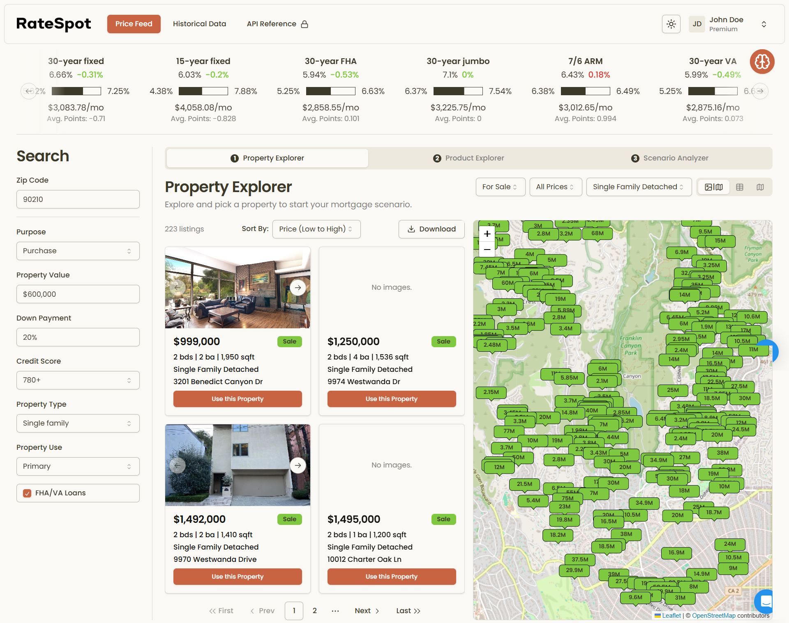

{/* Placeholder story to test the Markdown renderer. Replace with the real one. */}

## The Context

Buying a home in the US means talking to a dozen lenders, each one quoting rates in a slightly different way. **RateSpot** started as a simple idea: put every quote side by side, on top of the listings people were already browsing, and let them _see_ what a mortgage would actually cost them month by month.

The first version was a spreadsheet the founders shared with friends. When it reached a few hundred users, it was time to turn it into a real product. Nobody wanted ~~another rate table~~ a wall of numbers; they wanted an answer to a single question: _can I afford this house?_

### Who it was for

Three kinds of users showed up from the very first week:

- **First-time buyers**, who needed the most hand-holding:
  - What is an APR, and why is it different from the rate?
  - How much should I put down?
- **Repeat buyers**, who knew the jargon and just wanted the numbers.
- **Loan officers**, who used it to prepare scenarios for their own clients.

## My Role

I joined as the second engineer and ended up owning most of the stack:

1. The React frontend, from the map search to the scenario builder.
2. The Flask API and the pricing engine behind it.
3. Billing with Stripe, deployments and the Docker setup on DigitalOcean.
4. Later on, an AI assistant built with the `AI SDK` that explained each scenario in plain English.

> The goal was never to show the lowest rate. It was to show the rate you would actually get.
>
> Everything else was a consequence of that decision.

## Challenges

### Pricing in real time

Lenders publish their rate sheets as huge, inconsistent files. We normalized them into a single model and cached the results in Redis, so a full scenario could be priced in under `200ms`. A simplified version of the core calculation:

```ts
function monthlyPayment(principal: number, rate: number, years: number) {
  const r = rate / 12
  const n = years * 12
  return (principal * r) / (1 - Math.pow(1 + r, -n))
}
```

On the backend, each rate sheet went through the same pipeline before being stored:

```python
@dataclass
class RateQuote:
    lender_id: int
    product: str
    rate: Decimal
    points: Decimal

def normalize(sheet: RawSheet) -> list[RateQuote]:
    quotes = [parse_row(row) for row in sheet.rows if row.is_valid()]
    return sorted(quotes, key=lambda quote: (quote.rate, quote.points))
```

### Comparing apples to apples

Two quotes with the same rate can hide very different costs. This is the kind of comparison the scenario builder made obvious:

| Lender   | Rate   | Points | Closing costs | Monthly payment |
| -------- | -----: | -----: | ------------: | --------------: |
| Lender A | 6.25%  | 0.0    | $4,200        | $2,463          |
| Lender B | 6.00%  | 1.5    | $7,900        | $2,398          |
| Lender C | 6.125% | 0.5    | $5,100        | $2,430          |

Lender B looks cheaper every month, but it takes almost five years for the lower payment to make up for the extra closing costs.[^breakeven]

### Making the map usable

Showing thousands of listings on the Google Maps SDK killed performance on mobile. The fix came in three steps:

1. Cluster listings on the server instead of the client.
2. Only load details for the listings inside the viewport.
3. Price each listing lazily, the first time it is opened.
   - The first price is a quick estimate.
   - The exact one replaces it once the full scenario is ready.



#### A note on caching

Caching prices is risky: rates change several times a day. Every cached quote carried a short expiration, and the UI always showed _when_ a price was last updated.

### Deployments

Everything ran in Docker containers. Shipping a new version was a single command:

```bash
docker compose -f docker-compose.prod.yml up -d --build
```

Some of the settings that made the biggest difference, in case they help someone with a similar setup:

```json
{
  "workers": 4,
  "timeout": 30,
  "cache": { "quotes": "15m", "listings": "1h" }
}
```

---

## Outcome

RateSpot grew to thousands of monthly users and helped them compare more than a hundred lenders. Things I would keep doing on my next project:

- [x] Price everything on the server, never trust the client.
- [x] Show where every number comes from.
- [ ] Write the onboarding before the features, not after.

In 2025 the product was [replaced](https://example.com) by a new platform built by the same team, which reused most of the pricing engine I wrote. Press <kbd>Ctrl</kbd> + <kbd>K</kbd> on the new platform and you can still find some of it.

[^breakeven]: $3,700 in extra closing costs divided by $65 saved per month is roughly 57 months.
